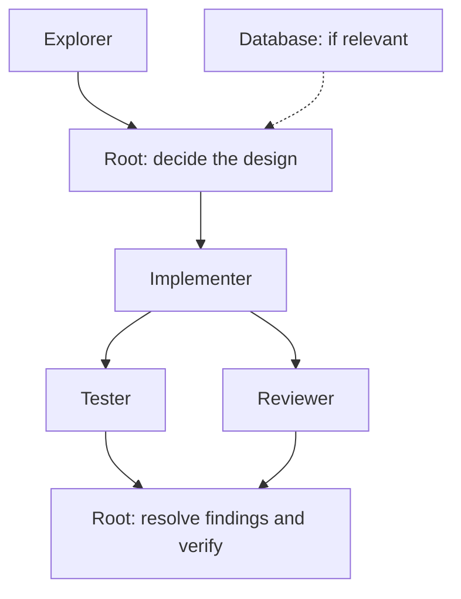
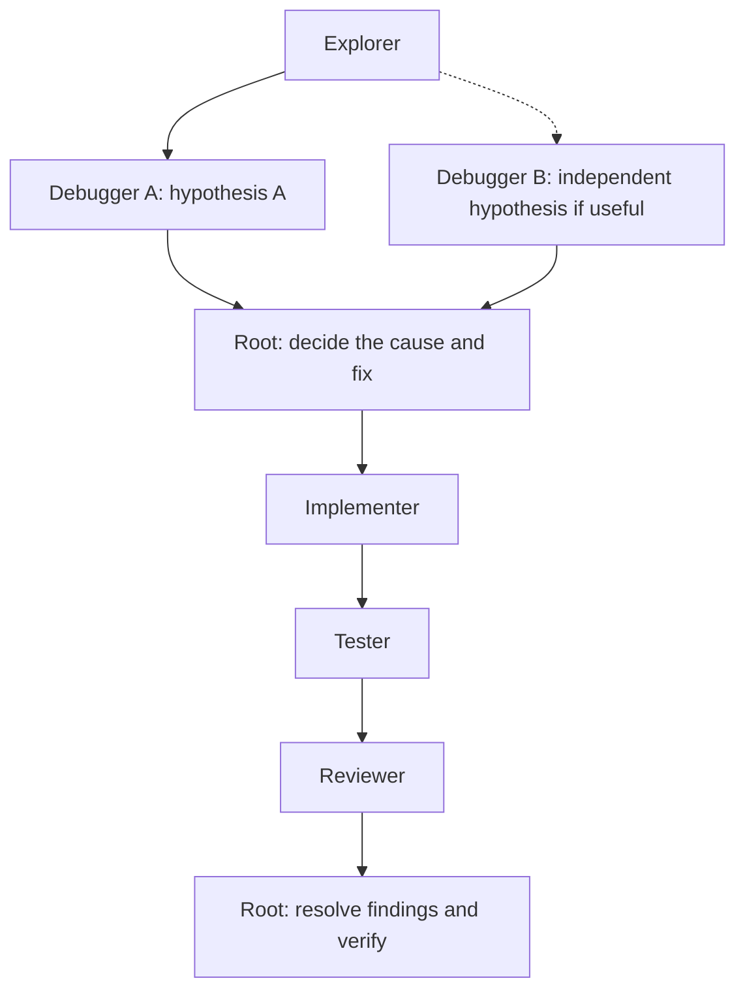
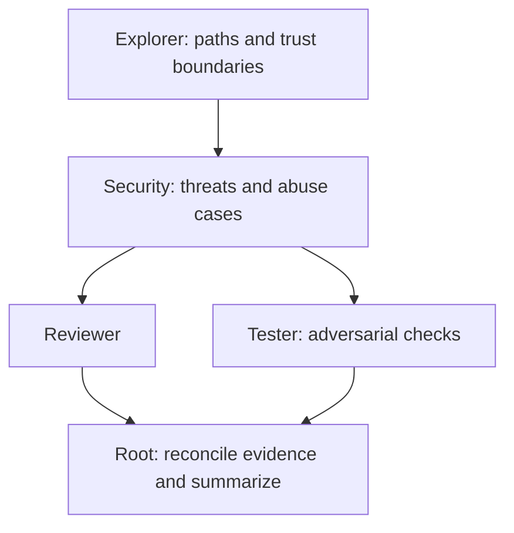

# Agent Rig

Reusable engineering workflows for **Codex** and **Claude Code**. Agent Rig installs specialist agents, workflow instructions, and presets into your projects or provider configuration directory.

The root agent owns the result: it chooses the design, delegates bounded work, reconciles findings, and verifies completion. Substantial changes get independent testing and review; simple changes stay with root.

**Rig is opt-in for each request.** Start a prompt with `rig feature:`, `rig bug:`, `rig review:`, `rig security:`, `rig plan:`, or `rig quick:` to activate it. The equivalent `@feature`, `@bug`, `@review`, `@security`, `@plan`, and `@quick` aliases remain supported for compatibility. Unprefixed requests use your existing setup.

[Quick start](#quick-start) · [Providers](#providers) · [Presets](#presets) · [Workflows](#workflows) · [Model policies](#model-policies) · [Updates and removal](#updates-and-removal) · [Customization](#customization) · [Development](#development)

## Quick start

Run the command for your provider from this checkout. The target project directory must already exist:

```bash
# Codex; --provider codex is also the default when omitted.
bin/agent-rig install --provider codex --target /path/to/project

# Claude Code.
bin/agent-rig install --provider claude --target /path/to/project
```

Run both commands against the same project to install both providers. Each defaults to the **full preset**: seven roles and six workflows. Add `--preset minimal`, `--preset backend`, or `--preset security` for a smaller set. Add `--dry-run` to preview changes without writing.

Before writing, the installer shows the provider, project/global scope, destination, preset, and planned file changes, then asks `Continue with installation? [y/N]`. Enter `yes` to proceed or `no` (or press Enter) to cancel. When the selected provider already has configuration, the summary explains that Rig merges its agents and managed instructions into the setup while preserving existing provider settings and surrounding instructions. Updates ask `Continue with update? [y/N]`; preset changes also require confirmation. Dry runs and unchanged installations do not prompt.

Terminal output uses colors and a progress bar that tracks completed file changes. Set `NO_COLOR=1` to disable colors. Redirected output and `TERM=dumb` use plain text with start/end progress lines. For unattended installs or updates, explicitly accept the plan with `--yes` (or `-y`):

```bash
bin/agent-rig install --provider codex --target /path/to/project --yes
```

Without `--yes`, an install or update that needs changes stops without writing if no confirmation input is available.

Start a new session of the selected provider in the target project, then make a request:

```text
rig feature: Add employee bonus calculations.
rig bug: Investigate why this payroll total is incorrect.
rig review: Review the latest changes.
rig security: Assess the authentication flow.
rig plan: Plan password reset support and save the plan as Markdown.
rig quick: Fix the typo in README.md.
```

Each line above is a separate example request. Installing roles makes them available; root uses only the specialists relevant to the task.

The installer requires **Bash 3.2+ and standard Unix utilities**. Use a provider release that supports its native agent files and the configured model/effort fields. Account model access and session permissions still apply.

### Install globally

Use `--global` instead of `--target` to make Rig available across projects:

```bash
bin/agent-rig install --provider codex --global --preset backend
bin/agent-rig install --provider claude --global --preset backend
```

| Provider | Global directory | Environment override |
| --- | --- | --- |
| Codex | `~/.codex` | `CODEX_HOME` |
| Claude Code | `~/.claude` | `CLAUDE_CONFIG_DIR` |

Custom directories work with install, update, and uninstall commands:

```bash
CODEX_HOME=/path/to/codex-home bin/agent-rig install --provider codex --global
CLAUDE_CONFIG_DIR=/path/to/claude-home bin/agent-rig install --provider claude --global
```

`--global` and `--target` are mutually exclusive. A missing global directory is created only when applying an install; updates require an existing installation, and a dry run creates no destination files or directories. Global workflow paths are absolute. If you relocate a provider home, run update to refresh them.

When a project and a global Rig installation are both present for the same provider, the Rig instructions select the project's preset, role list, and workflow paths. Repository conventions still govern the work.

## Providers

Both providers expose the same role, workflow, and preset names. Their native files, orchestration instructions, models, and installation state are independent.

| | Codex | Claude Code |
| --- | --- | --- |
| Project instructions | `AGENTS.md`, or an active `AGENTS.override.md` | `CLAUDE.md` |
| Project agents | `.codex/agents/agent_rig_<role>.toml` | `.claude/agents/agent-rig-<role>.md` |
| Agent format | Native TOML | Native Markdown with YAML frontmatter, rendered from provider templates |
| Rig state | `.agent-rig/codex/` | `.agent-rig/claude/` |
| Sources | [providers/codex/](providers/codex/) | [providers/claude/](providers/claude/) |

A project with both installed has this layout:

```text
project/
├── AGENTS.md                         # Or active AGENTS.override.md
├── CLAUDE.md
├── .codex/
│   ├── config.toml                   # Existing settings preserved
│   └── agents/agent_rig_<role>.toml
├── .claude/
│   └── agents/agent-rig-<role>.md
└── .agent-rig/
    ├── codex/
    │   ├── workflows/<workflow>.md
    │   ├── reviewers/claude.sh        # Optional external review runner
    │   ├── manifest.tsv
    │   └── backups/<run>/            # Created when existing files change
    └── claude/
        ├── workflows/<workflow>.md
        ├── reviewers/codex.sh
        ├── models/policy.tsv
        ├── manifest.tsv
        └── backups/<run>/
```

Global installations use `agents/` directly inside the selected provider home, along with its instruction file and `.agent-rig/<provider>/` state.

Installing, updating, removing, or rolling back one provider preserves the other provider's files. Each has its own manifest, backups, and shared lifecycle lock. Claude does not import Codex instructions, and neither provider consumes the other's model policy.

### Existing configuration

**Codex:** existing project `.codex/config.toml` and global `config.toml` remain byte-for-byte unchanged. If absent, Rig creates comment-only guidance. If your setup disables multi-agent tools and you want Rig delegation, reconcile `enabled = true` in the existing `[agents]` table, or add the table if absent. Avoid duplicate tables. See [configuration guidance](providers/codex/templates/config.toml) and the [Codex subagent reference](https://learn.chatgpt.com/docs/agent-configuration/subagents).

The Codex installer uses a nonempty `AGENTS.override.md` when present; otherwise it uses `AGENTS.md` and leaves empty or whitespace-only overrides untouched. A later install moves the managed section if an override becomes active, preserving surrounding instructions in both files. This applies to project and global installations; see the [instruction discovery reference](https://learn.chatgpt.com/docs/agent-configuration/agents-md).

**Claude Code:** Rig preserves settings JSON, permissions, hooks, skills, and memory configuration. Explorer, database, reviewer, and security have only Read, Grep, and Glob tools. Implementer and tester can edit assigned files and execute checks; debugger can run safe checks without editing source. Rig uses native subagents within one root session. See the [Claude subagent reference](https://code.claude.com/docs/en/sub-agents) and [instruction file reference](https://code.claude.com/docs/en/memory).

## Presets

A preset selects which roles and workflows are installed for either provider:

| Preset | Available roles | Available workflows |
| --- | --- | --- |
| `minimal` | explorer, implementer, tester, reviewer | plan, feature, bug, quick |
| `backend` | explorer, implementer, database, tester, reviewer, debugger | plan, feature, bug, review, quick |
| `security` | explorer, security, reviewer, tester, debugger | plan, security, review, bug, quick |
| `full` (default) | all seven roles | plan, feature, bug, review, security, quick |

Root handles a stage when its specialist is absent. For example, minimal leaves uncertain diagnosis with root, while security leaves implementation with root. An unavailable review or assessment workflow does not authorize implementation; root adapts the process to the requested outcome. Plan is available in every preset and allows only the requested Markdown plan and required parent directories to be saved.

Definitions are maintained separately in [Codex presets](providers/codex/presets/) and [Claude presets](providers/claude/presets/).

## Workflows

The workflow prefix must appear at the beginning of the request, after optional whitespace. Use `rig <workflow>:` as the recommended form, including the required colon. Existing standalone `@` aliases remain supported for compatibility and select the same workflows. Aliases are prompt conventions, not native provider commands. Quoting an alias, showing it as an example, or mentioning it later does not activate Rig. Activation is evaluated again for every request.

| Recommended prefix | Compatibility alias | Use for | Normal stages |
| --- | --- | --- | --- |
| `rig feature:` | `@feature` | Non-trivial feature development | Explore → root design → implement → independent testing/review → root verification |
| `rig bug:` | `@bug` | A failure whose cause needs investigation | Explore → investigate hypotheses → root diagnosis → implement → test → review |
| `rig review:` | `@review` | Existing code or a proposed change | Relevant reviewers → root summary |
| `rig security:` | `@security` | Security assessment | Explore → security analysis → independent review/testing → root summary |
| `rig plan:` | `@plan` | Research and save a Markdown implementation plan | Inspect → clarify → root plan → choose destination → save and verify |
| `rig quick:` | `@quick` | Trivial or low-risk changes | Root inspects → edits → verifies |

### Choose a reviewer provider

Put `reviewer=claude` or `reviewer=codex` immediately after the workflow prefix to choose who reviews the work:

```text
# From Codex, ask Claude to review.
rig review: reviewer=claude Review the current changes.

# From Claude Code, ask Codex to review after implementation.
rig feature: reviewer=codex Add password reset.

# Compatibility aliases accept the same modifier.
@bug reviewer=claude Fix the failing import.
```

Omitting the modifier keeps the normal native reviewer. Selecting the current provider also uses its native reviewer. Selecting the other provider runs its CLI for the reviewer stage while root retains ownership of implementation, testing, and findings. Feature, bug, review, and security support the modifier; quick and plan report it as unsupported and retain their normal boundaries. Quoted examples and tokens later in the request do not select a reviewer. Unknown values or repeated leading modifiers are invalid.

The other provider's CLI must be on PATH, authenticated, and compatible with the runner flags; a second Rig installation is unnecessary. The Codex runner also requires Python 3 to inspect and disable configured MCP servers safely. Missing access, denied execution, CLI failures, and empty or incomplete results are reported as an incomplete requested review, with no silent substitution. Rig does not install or authenticate CLIs, bypass session guards, or change permission settings. External reviews use the selected CLI's configured model defaults, independently of Rig's native reviewer model policy.

Each installation manages a runner under its own `.agent-rig/<provider>/reviewers/` directory, including updates, protected local edits, backups, and uninstall. Root invokes it through Bash with the working project as `--target` and a review brief on stdin. The brief identifies requirements, a stable target/base, relevant files including untracked work, and checks already performed. Claude's runner has only Read, Grep, and Glob, so root supplies the diff for change reviews. Codex's runner uses the read-only sandbox, denies approval requests, and disables MCP servers, apps, plugins, delegation, browser, and computer tools for the invocation; Claude's disables editing, shell, skills, and MCP tools. Configured permission hooks remain in place. These use the providers' existing runtime controls, not a separate isolation environment. The runner returns findings to root for reconciliation and follow-up review after accepted fixes.

Update an existing Rig installation from this checkout to load this capability, then start a new provider session. See the [Codex noninteractive CLI documentation](https://learn.chatgpt.com/docs/non-interactive-mode) and [Claude CLI reference](https://code.claude.com/docs/en/cli-reference) for the underlying execution options.

### Feature

Root decides the design and assigns file ownership before implementation. Database analysis participates only when persistence concerns are relevant.



Tester and reviewer may run in parallel once implementation stabilizes, with test writes outside the review target. Accepted fixes and subsequent tests receive affected testing and follow-up review.

Workflow definitions: [Codex feature](providers/codex/workflows/feature.md) · [Claude feature](providers/claude/workflows/feature.md).

### Bug

Establish expected behavior and a reproduction, then investigate discriminating hypotheses before applying a fix.



Debugger A and B are separate instances of the same role. Use a second instance when it adds independent evidence. Root investigates when debugger is absent; an obvious low-risk fix can use quick.

Workflow definitions: [Codex bug](providers/codex/workflows/bug.md) · [Claude bug](providers/claude/workflows/bug.md).

### Review and security

Review examines a stable target and adds security or database expertise only when relevant. Root reconciles evidence and ranks actionable findings. Review and security assessments report findings and recommendations; persistent fixes or test edits require a request for changes.

Security adds independent review and adversarial testing:



Assessment-only testing uses existing checks or disposable reproductions without persistent source edits. Findings are ranked CRITICAL, HIGH, MEDIUM, or LOW and include evidence, impact, and limitations. Agents should state when no meaningful issues are found.

Workflow definitions: [Codex review](providers/codex/workflows/review.md) · [Claude review](providers/claude/workflows/review.md) · [Codex security](providers/codex/workflows/security.md) · [Claude security](providers/claude/workflows/security.md).

### Plan

Plan researches the requested changes and saves an actionable Markdown document without implementing them. Root resolves blocking decisions and owns the final plan, covering the goal, intended behavior, implementation steps, affected interfaces, tests, risks, and assumptions. Installed specialists may perform bounded read-only research or review when useful; no new role is required.

Unless the request supplies a destination, root asks where to save and proposes `<invocation-directory>/<descriptive-kebab-case-slug>.md`. An explicitly empty reply accepts the default; silence does not. Relative paths resolve against the working directory recorded at invocation, and a supplied directory gets the proposed filename. For an existing filename, root proposes an available numbered alternative unless the user explicitly requested updating that plan. Updates preserve unrelated content.

Only the plan document and required parent directories may be written. Root reads the saved file back, links it, and stops without implementation. If the runtime prohibits writes, root returns the complete plan in chat with its intended destination and saving pending; Rig does not switch modes or bypass permissions. A save or verification failure also returns the complete plan in chat and reports the failure. Saved plans are user artifacts outside installer manifests, so Rig updates and uninstall preserve them.

Workflow definitions: [Codex plan](providers/codex/workflows/plan.md) · [Claude plan](providers/claude/workflows/plan.md).

### Quick and coordination

Quick stays root-only for typos, small documentation edits, bounded mechanical renames, and obvious configuration corrections. If inspection reveals broader effects or uncertainty, root explains a change to the smallest suitable workflow.

Across workflows, root assigns bounded tasks with context and explicit file ownership. Independent analysis can run in parallel; overlapping edits are sequenced. Testing and review stay independent of implementation. Root reconciles findings, coordinates corrections, and performs final verification within the runtime's concurrency limits.

Plan Mode stays planning, including delegated work. Project conventions, user instructions, and existing permission boundaries continue to apply. Codex nested delegation requires explicit root authorization and a clear benefit; Claude Rig subagents return to root without spawning more agents.

Workflow definitions: [Codex quick](providers/codex/workflows/quick.md) · [Claude quick](providers/claude/workflows/quick.md).

### Specialist roles

| Role | Responsibility | Expected result |
| --- | --- | --- |
| explorer | Trace architecture, execution paths, dependencies, and conventions | Relevant files, constraints, risks, and implementation areas |
| implementer | Carry out the root-approved design within assigned files | Scoped changes, checks, and remaining concerns |
| database | Analyze schema, SQL, migrations, indexes, transactions, and integrity | Persistence findings, design tradeoffs, and verification recommendations |
| tester | Independently check requirements, edge cases, regressions, and failures | Test scenarios, commands/results, defects, and coverage gaps |
| debugger | Investigate one bounded failure hypothesis | Supporting/contradicting evidence, diagnosis, and smallest fix recommendation |
| reviewer | Independently inspect a stable implementation | Actionable ranked findings, or a clear report of no findings |
| security | Assess reachable threats, trust boundaries, and abuse cases | Evidence-backed findings, mitigations, and adversarial scenarios |

Agent definitions: [Codex agents](providers/codex/agents/) · [Claude agent templates](providers/claude/agents/).

## Model policies

Model selection belongs to each provider. The user's root model and effort remain unchanged, including for quick. Role defaults apply when a Rig specialist is delegated an activated task; local native overrides are protected on future installs.

### Choose your own models and effort

Prepare an editable config before installing. Generate it in the Rig checkout, the destination project, or a provider home:

```bash
# Start from defaults and edit models.ini manually.
bin/agent-rig config init --rig
bin/agent-rig config init --target /path/to/project

# Or answer model and effort prompts for each role.
bin/agent-rig config init --target /path/to/project --interactive
bin/agent-rig config init --global --provider codex --interactive
```

`--rig` writes `<rig-checkout>/models.ini`; `--target` writes `<target>/.agent-rig/models.ini`. Both include all seven roles for both providers unless `--provider codex` or `--provider claude` is supplied. `--global` writes `<provider-home>/.agent-rig/models.ini` and requires a single provider. Project targets must already exist. Creation does not install Rig or change provider settings. Existing config files are protected; edit them manually or explicitly pass `--overwrite`. Interactive creation previews the complete file and asks before saving, including on overwrite. Enter keeps a setting at `default`; EOF or cancellation saves nothing.

Generated files use `default` as their active values, with current model and effort defaults in comments. Untouched settings follow future shipped defaults. Replace individual values to pin choices:

```ini
[codex.reviewer]
model = gpt-6.1-sol
effort = high

[claude.implementer]
model = claude-sonnet-5-5
effort = high
```

Install/update automatically discovers the checkout config and the target's config, or the provider home's config for `--global`. It lists the paths and asks `Apply these model configuration files? [y/N]`. Target entries override checkout entries. Declining skips both files while retaining saved choices and explicit role flags. Use `--models-config FILE` to select a single file instead of discovery; relative paths resolve from the invocation directory. There is still a loading question for an explicit file.

For automation, choose `--use-models-config` to accept loading or `--ignore-models-config` to skip discovery. **`--yes` accepts installation only**, so unanswered config consent stops without changing the target. Dry runs also ask about discovered files unless a consent flag is supplied, and never write.

```bash
bin/agent-rig install --provider codex --target /path/to/project --use-models-config

# Explicit role flags take precedence over file values; repeat for other roles.
bin/agent-rig update --provider codex --target /path/to/project \
  --ignore-models-config --role-model reviewer=gpt-6.1-sol --role-effort reviewer=high

# Clear one setting, a role, or all saved overrides.
bin/agent-rig update --target /path/to/project --ignore-models-config --role-effort reviewer=default
bin/agent-rig update --target /path/to/project --ignore-models-config --reset-role reviewer
bin/agent-rig update --target /path/to/project --ignore-models-config --reset-role all
```

Precedence is shipped defaults → saved overrides → requested resets → checkout config → target config → CLI role flags. Explicit file input replaces the two discovered files. Imports merge specified settings; omitted entries retain earlier choices, while `default` clears that setting's earlier override. To reset without reapplying file choices, pass `--ignore-models-config`.

Both model and effort can be overridden independently. Effort accepts `low`, `medium`, `high`, `xhigh`, and `max`; Claude also accepts `omit` to remove its native effort field. Haiku requires omitted effort. Changing Claude explorer from Haiku to another model requires an explicit effort or `omit`. Model IDs may contain letters, digits, dots, underscores, hyphens, slashes, colons, and plus signs, starting with a letter or digit. Custom IDs need not be in Rig's shipped lineup; access and unknown model/effort compatibility are checked by the provider runtime, not the installer. Inheritance is not a config value; `default` means Rig's shipped setting.

INI files support blank lines, full-line `#` or `;` comments, and unquoted `model`/`effort` values in `[provider.role]` sections. Duplicate sections/keys and unknown providers, roles, settings, or malformed values are rejected. The entire accepted file is validated, but only the selected provider's entries apply. CLI assignments cannot repeat the same role/setting. No configuration is evaluated as code, and installation needs no additional dependencies.

Explicit choices are saved in `.agent-rig/<provider>/models/overrides.ini` and retained across installs, updates, and preset switches. Roles omitted by a preset keep their saved choices for later. This saved state participates in conflict protection, backups, rollback, and uninstall; manage choices through input files or flags. Manually edited native agents remain protected, so adopting overrides over conflicting local edits requires the existing `--replace-modified` option. User-authored `models.ini` files remain through uninstall; the checkout-root copy is gitignored. Root session settings and external-review CLI defaults remain unchanged.

### Codex defaults

Codex roles specify `model` and `model_reasoning_effort` in their TOML files:

| Roles | Model | Effort |
| --- | --- | --- |
| explorer | `gpt-6-luna` | high |
| implementer, database, tester | `gpt-6.1-sol` | high |
| debugger, reviewer, security | `gpt-6-astra` | high |

These are the shipped starting defaults, not per-role benchmark results. Customize the native role files; removing both model and effort keys restores inheritance. See [Codex model policy](providers/codex/models/README.md) and the [configuration reference](https://learn.chatgpt.com/docs/config-file/config-reference).

### Claude defaults

[policy.tsv](providers/claude/models/policy.tsv) centrally defines Claude role tiers, pinned IDs, effort defaults, pricing metadata, and quality targets. Installation renders explicit native model/effort fields into each agent and records a policy copy in `.agent-rig/claude/models/policy.tsv`.

| Tier | Roles | Pinned model | Effort |
| --- | --- | --- | --- |
| FAST | explorer | `claude-haiku-4-5-20251001` | omitted; unsupported |
| BALANCED | implementer, database, tester, debugger | `claude-sonnet-5-5` | medium |
| STRONG | reviewer, security | `claude-opus-5-5` | high |
| ESCALATION | exceptional bounded attempts only | `claude-fable-5-1` | high for definitions using this tier |

All presets share this policy. Escalation is an explicit, bounded response to unresolved evidence or high-impact risk, and is absent from normal workflow stages. A native model override does not automatically change the role's effort. Rig does not silently upgrade pins during installation.

The policy was reviewed on October 5, 2026. Its quality thresholds are initial targets; live benchmarks are needed to establish the cheapest reliable model for each role. See [Claude policy details, pricing, and escalation rules](providers/claude/models/README.md) and the [benchmark suite](providers/claude/benchmarks/README.md). Account and runtime restrictions can override requested models; record the actual selection during evaluation.

## Updates and removal

Run update from your current checkout to refresh an existing provider installation without uninstalling:

```bash
bin/agent-rig update --provider claude --target /path/to/project --dry-run
bin/agent-rig update --provider claude --target /path/to/project

# Optionally switch the installed preset.
bin/agent-rig update --provider claude --target /path/to/project --preset backend
```

Use `--provider codex` for Codex, or `--global` instead of `--target` for a global installation. **Update retains the recorded preset unless `--preset` is supplied.** It requires a valid manifest for the selected provider; use install for a new destination. An unchanged update is a no-op.

Update applies the source files in this checkout; it does not fetch releases, run `git pull`, or update the CLI itself. Obtain the desired source revision first, then run update for each installation. Repeat install remains supported and defaults to **full** whenever `--preset` is omitted.

### Local edits and backups

The selected provider's manifest records ownership and checksums for managed agents, workflows, instruction sections, and any generated policy. Updates preserve existing configuration and instructions outside Rig sections. Missing managed files are recreated; a removed instruction section remains a protected local change.

| Situation | Behavior |
| --- | --- |
| Managed content is unchanged or already matches the new output | Update or adopt the matching content |
| Managed content has differing local edits, or an unmanaged destination conflicts | Stop before writing; report conflicts |
| `--replace-modified` is supplied to install or update | Back up conflicting content and apply replacement or preset removal |
| Preset drops a previously managed role/workflow | Remove that tracked content, subject to local-edit protection |
| Markers/manifest are malformed, paths are unsafe, scopes conflict, or destinations are symlinks | Stop; replacement flags do not bypass these checks |

```bash
bin/agent-rig update --provider claude --target /path/to/project --preset backend --replace-modified
```

Every existing file changed or deleted is backed up under `.agent-rig/<provider>/backups/<run>/`; the command reports the directory. Install, update, and uninstall stage changes, share the provider's lock, and attempt to restore originals on write failure. Backups are retained; empty directories may remain. Avoid editing destinations during a run. Before removing a leftover `.install-lock`, confirm no operation is running.

### Uninstall

```bash
# Preview and remove one provider from a project.
bin/agent-rig uninstall --provider claude --target /path/to/project --dry-run
bin/agent-rig uninstall --provider claude --target /path/to/project

# Remove Codex from its global directory.
bin/agent-rig uninstall --provider codex --global

# Back up and remove locally customized Rig content explicitly.
bin/agent-rig uninstall --provider claude --target /path/to/project --remove-modified
```

Uninstall removes recorded managed files, the marked instruction section, and the manifest. It preserves instructions outside the section byte-for-byte, unrelated files, configuration, and backup history. Empty instruction files and directories may remain. Additional Codex Rig sections in the other instruction file require explicit removal through `--remove-modified`.

Already missing managed content is accepted. Without a manifest, uninstall leaves the destination untouched rather than guessing ownership. A missing global directory is not created by removal. Removing a project installation leaves its global installation intact, and removing one provider leaves the other intact. Start a new provider session afterward.

`--replace-modified` is for install or update; `--remove-modified` is for uninstall. Run `bin/agent-rig --help` for the complete command options.

### Legacy Codex migration

An existing `.agent-rig/manifest.tsv` identifies a legacy Codex installation. The next Codex install or update validates recorded ownership and local edits, moves tracked workflows to `.agent-rig/codex/workflows/`, refreshes instruction paths, and replaces the old manifest with `.agent-rig/codex/manifest.tsv`. Earlier managed generic role names are migrated to the `agent_rig_` namespace.

Changed or removed files are backed up in the new Codex backup directory. Old `.agent-rig/backups/` history and untracked content stay in place. A dry run previews migration without writing; local edits remain protected. Migration takes both the legacy and new Codex locks. If both manifests exist, reconcile them manually before proceeding.

Codex uninstall can remove legacy state directly. Claude operations leave that state untouched. If an older Rig installation enabled multi-agent tools in Codex configuration, remove that setting manually when you prefer inherited settings; the installer preserves existing configuration.

## Customization

Keep repository conventions and project-specific requirements outside the Rig markers in `AGENTS.md`, the active `AGENTS.override.md`, or `CLAUDE.md`:

```markdown
# Project instructions

Run the project's test command. Follow its API conventions.

<!-- agent-rig:begin -->
...installed Rig instructions...
<!-- agent-rig:end -->

Additional project instructions can go here.
```

Updates preserve content outside the managed section byte-for-byte, including CRLF line endings. Edits inside the section, even line-ending changes, remain protected local modifications. Relative project workflow paths resolve against the file containing the Rig section, including when a session starts in a project subdirectory.

Use [model configuration](#choose-your-own-models-and-effort) for persistent model and effort choices, or edit installed native agents and workflows directly to customize one setup. Native edits remain protected; editing the installed Claude policy copy alone does not re-render agents. Change provider source assets to set defaults for future installs. Claude source agents contain model/effort placeholders and must be rendered by installation before use.

Commit installed instructions, agents, workflows, policy copies, and manifests when teammates should share the setup. Keep backups and temporary locks out of project version control, for example:

```gitignore
.agent-rig/*/backups/
.agent-rig/*/.install-lock/
```

The installer does not edit the target project's `.gitignore`. Keep legacy backup history ignored too if that project has an older installation.

## Development

Provider-specific implementation lives under separate source trees:

```text
bin/agent-rig                         # Shared installation lifecycle
providers/
├── codex/{agents,workflows,presets,templates,models}/
└── claude/{agents,workflows,presets,templates,models,benchmarks}/
tests/
├── codex/
└── claude/
```

Each trusted `provider.sh` adapter owns native paths, rendering, instruction discovery, configuration handling, and ownership patterns. Core manages provider selection, presets, conflict handling, manifests, backups, locks, and rollback without parsing native agent syntax. Provider validators check their own formats.

### Automated checks

Development checks require Make and Python 3.11+:

```bash
make check
```

The suite validates native agent output, presets, references, Markdown links/fences, and source formatting. Disposable project and global fixtures cover installation confirmation, terminal colors and progress, updates, removal, coexistence, legacy migration, protected edits, model policy rendering, preserved instruction bytes, unsafe-path rejection, locks, and injected failures that exercise rollback. It does not change your actual provider installations or call models.

To run checks individually:

```bash
python3 tests/validate.py
python3 tests/installer.py
bash tests/update.sh
bash tests/codex/install.sh
bash tests/codex/uninstall.sh
bash tests/codex/migration.sh
bash tests/claude/install.sh
bash tests/claude/models.sh
python3 providers/claude/benchmarks/evaluate.py --check
python3 tests/claude/benchmarks.py
```

### Runtime smoke checks and benchmarks

Install minimal into a disposable project, start a new authenticated provider session, and request exploration without edits:

```text
rig feature: Explore this repository and propose a feature plan without edits.
Use the installed Rig explorer to identify relevant files, report available
roles and workflows, and wait for its findings.
```

Confirm the namespaced explorer runs and returns evidence. Repeat with `@feature` to check the compatibility alias. Try `rig quick:` on a documentation change and confirm root handles it alone. Then make an unprefixed request and confirm the existing process applies. For Claude, also try a small feature with independent testing and review; inspect agent definitions through `/agents` or ask the session to list them. Repeat with a nested working directory and a global installation when applicable.

For plan, use disposable projects and verify these scenarios in authenticated sessions for both providers (repeat with `@plan`):

| Scenario | Expected behavior |
| --- | --- |
| No destination, then explicitly empty reply | Save at the proposed Markdown path in the invocation directory; silence leaves saving pending |
| Custom relative/absolute path or directory | Use the supplied path without asking again; append the filename for a directory |
| Invocation from a nested working directory | Resolve defaults and relative destinations from that directory |
| Existing filename | Propose an available numbered alternative and wait for the destination choice |
| Explicit update of an existing plan | Update that document and preserve unrelated content |
| Completed planning request | Verify and link the plan; source, tests, configuration, and other artifacts remain unchanged |
| Runtime prohibits writes | Return the complete plan in chat with destination and pending-save status |
| Save or verification failure | Return the complete plan in chat and report the failure without claiming a verified save |

Automated checks validate configuration and lifecycle behavior; authenticated sessions verify real delegation and model access. The [Claude benchmark guide](providers/claude/benchmarks/README.md) describes seven seeded role tasks, independent grading, and reporting for latency, tool reliability, cache-aware costs, retries, failed workflows, and root verification. Passing offline checks does not establish live model quality.
